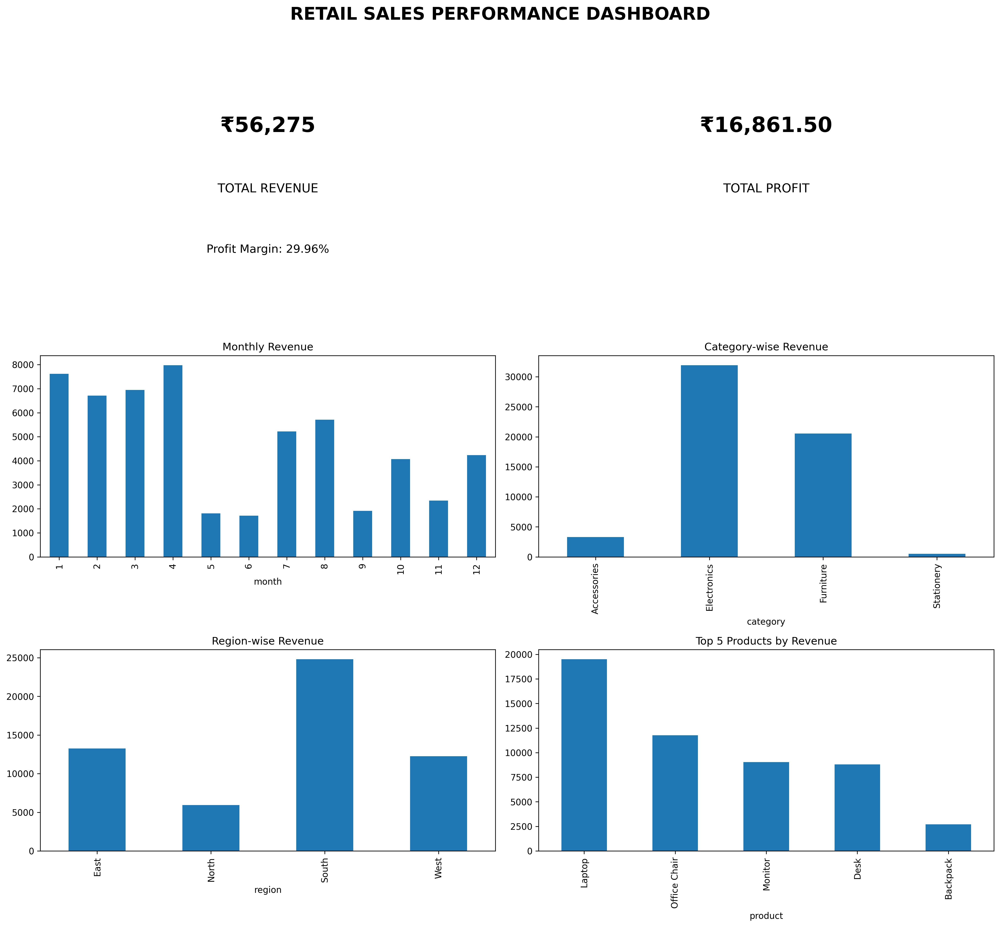

# Retail Sales Analysis Using Python

## Project Overview
This project analyzes retail sales data using Python to identify
sales trends, profitable products, and regional performance.

## Tools Used
- Python
- Pandas
- NumPy
- Matplotlib
- Google Colab

## Key Findings
- Total Revenue: ₹56,275
- Total Profit: ₹16,861.50
- Profit Margin: 29.96%
- Top Revenue Product: Laptop
- Best Performing Region: South

## Project Files
- Retail_Sales_Analysis.ipynb
- retail_sales_dashboard.png

## Conclusion
The analysis helps identify high-performing products,
categories, and regions to support better business decisions.
## Dashboard Preview

## Tableau Public Portfolio

Explore my Tableau dashboards here:

[View My Tableau Dashboards](https://public.tableau.com/app/profile/karteek.vallepu/vizzes)
